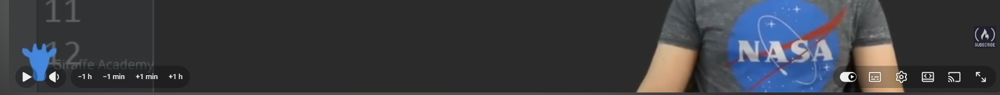
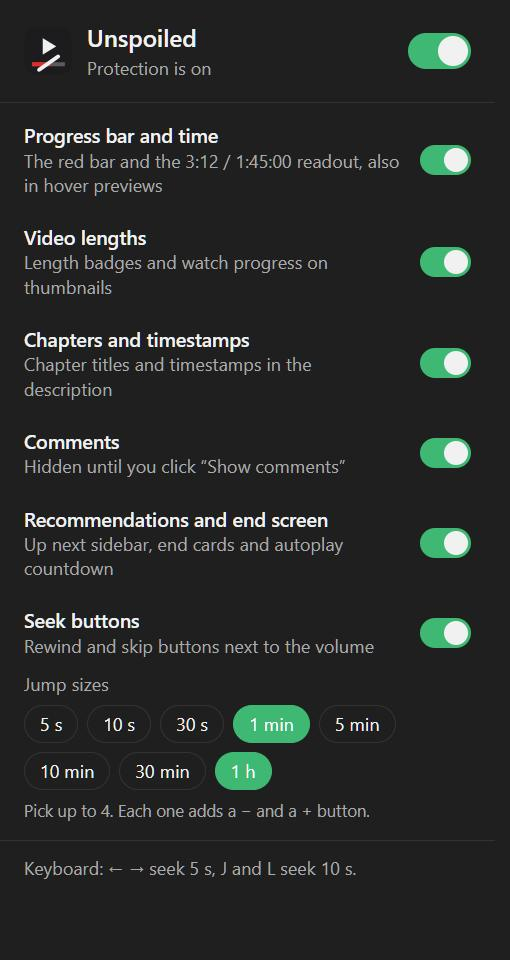
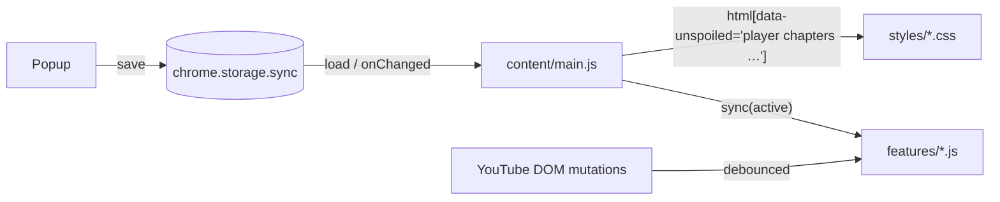

<p align="center">
  
</p>

<h1 align="center">Unspoiled for YouTube</h1>

<p align="center">
  Watch YouTube without knowing how long the video is, how much is left, or how it ends.
</p>

<p align="center">
  <a href="https://github.com/fernMPdev/unspoiled/actions/workflows/ci.yml"></a>
  
  
  <a href="LICENSE"></a>
</p>

---

A progress bar is a spoiler. If a match has 20 minutes left, it's not going to
penalties. If a thriller is at 90%, the twist is coming. Unspoiled removes every
clue about length and position from YouTube, and gives you buttons to seek
without one.

## Features

| Feature                        | What it hides                                                                             |
| ------------------------------ | ----------------------------------------------------------------------------------------- |
| Progress bar and time          | Red bar, `3:12 / 1:45:00`, storyboard previews, also in hover previews and the miniplayer |
| Video lengths                  | Length badges and watch-progress bars on every thumbnail                                  |
| Chapters and timestamps        | Chapter title in the player, chapter lists, timestamps in the description                 |
| Comments                       | Gated behind a **Show comments** button that resets on every video                        |
| Recommendations and end screen | Up-next sidebar, end cards, autoplay countdown                                            |
| Seek buttons                   | _Adds_ rewind and skip buttons next to the volume control, with jump sizes you choose     |

<p align="center">
  
</p>



Every feature can be toggled from the toolbar popup, and a master switch turns
everything off. Changes apply instantly to open tabs, and settings sync across
your Chrome profile.

### Seek steps

Pick up to four jump sizes: 5 s, 10 s, 30 s, 1 min, 5 min, 10 min, 30 min or
1 h. Each one adds a − and a + button, with the largest jumps on the outside.
With 1 min and 1 h you get `−1 h` `−1 min` `+1 min` `+1 h`. The default is
10 s and 1 min.

YouTube's own shortcuts keep working: <kbd>←</kbd> <kbd>→</kbd> seek 5 s,
<kbd>J</kbd> <kbd>L</kbd> seek 10 s.

<br clear="right">

## Install

Unspoiled is not on the Chrome Web Store yet. To load it from source:

1. Download the latest `unspoiled-vX.Y.Z.zip` from
   [Releases](https://github.com/fernMPdev/unspoiled/releases) and unzip it,
   or clone this repo.
2. Open `chrome://extensions` (or `edge://extensions`) and turn on **Developer mode**.
3. Click **Load unpacked** and select the unzipped folder, or `extension/` if you cloned the repo.

## How it works



- **Hiding is pure CSS.** The content script writes the active feature ids to
  `<html data-unspoiled="…">` at `document_start`. Each stylesheet is scoped to
  its feature with `html[data-unspoiled~="feature"]`, so elements are hidden
  before YouTube paints them and turning a feature off is one attribute change.
- **Spoiler-safe by default.** Defaults are applied synchronously before the
  user's settings are read from storage, so nothing flashes on screen while
  loading. If storage fails, everything stays hidden.
- **Features that add UI** (seek buttons, comment gate, timestamp tagging)
  implement an idempotent `sync(active)`. YouTube is a single-page app that
  rebuilds its DOM constantly, so `sync` re-runs after every debounced batch of
  mutations and on `yt-navigate-finish`. A failing feature is isolated and
  logged without breaking the others.
- **No build step, no runtime dependencies.** The extension is plain scripts
  sharing a `globalThis.Unspoiled` namespace. Types are still enforced:
  `tsc --checkJs` verifies the JSDoc annotations against
  [`types/unspoiled.d.ts`](types/unspoiled.d.ts).

## Project structure

```
extension/                  # what gets loaded into Chrome
├── manifest.json
├── _locales/en/            # every user-facing string
├── icons/
└── src/
    ├── shared/             # i18n, settings and time helpers, used by content script and popup
    ├── content/
    │   ├── lib/            # DOM watcher
    │   ├── features/       # seek controls, comment gate, timestamp masker
    │   └── main.js         # entry point, wires everything up
    ├── styles/             # one stylesheet per feature
    └── popup/
test/                       # node:test unit tests
types/                      # ambient types for tsc --checkJs
scripts/                    # icon generator
```

## Development

Requires Node.js 20+.

```bash
npm install
npm run check      # lint + format check + type check + tests
npm run format     # apply Prettier
```

After editing, click the reload icon on the extension card in
`chrome://extensions` and refresh YouTube.

### When YouTube changes its markup

YouTube ships redesigns often and sometimes runs several generations of markup
at once. If something reappears, inspect it in DevTools and add its selector to
the matching file in [`extension/src/styles/`](extension/src/styles). Each file
documents which part of the page it covers.

### Releasing

1. Bump `version` in both `package.json` and `extension/manifest.json`.
   A test fails if they differ.
2. Add an entry to [`CHANGELOG.md`](CHANGELOG.md).
3. Tag and push: `git tag v1.1.0 && git push --tags`. The release workflow runs
   the checks, verifies the tag matches the manifest, and attaches the zip to
   a GitHub release.

## Known limitations

- Chrome's global media controls and the Windows media flyout can still show a
  progress bar. They are drawn by the browser and the OS, outside the page.
- Hiding a description timestamp leaves the text written next to it.
- The `&t=` parameter in a resumed video's URL shows where you left off.

## License

[MIT](LICENSE)
